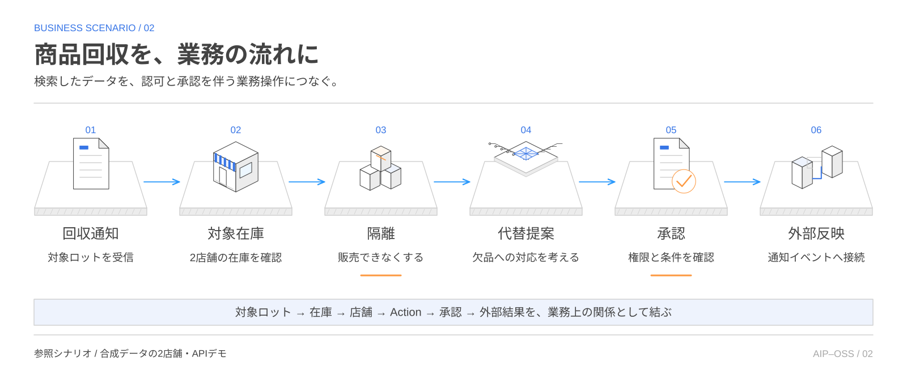
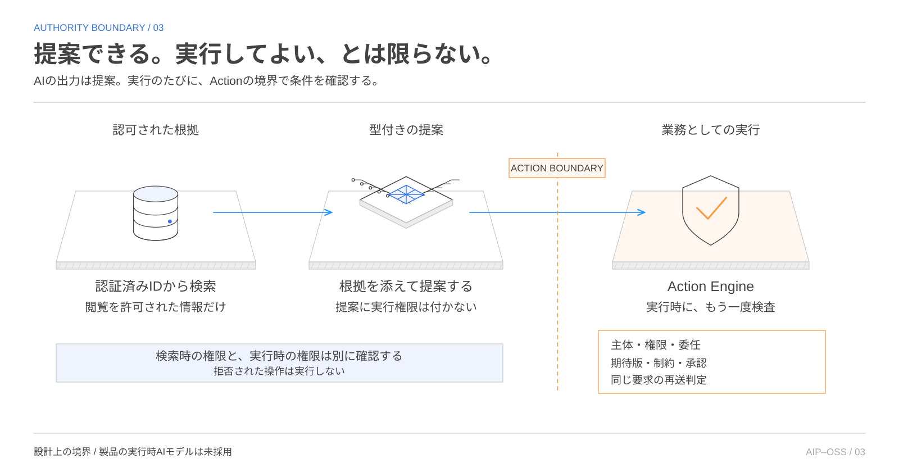
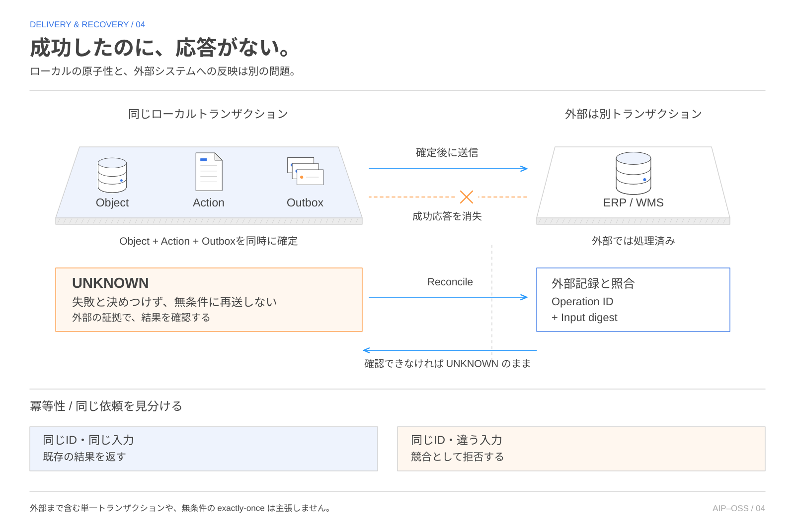

# 業務の意味と実行ルールを、自分たちで持つ。

これはカンリーとは一切関係のない、萩野個人の開発・検証の記録です。業務としての開発ではなく、会社や顧客の実データも使用していません。Palantirの公式プロジェクトでもありません。ソースコードは[GitHubリポジトリ](https://github.com/haginot/aip-oss-platform)で公開しています。

AIP-OSS Platformは、データ、認可、ワークフロー、AIを、企業が管理する業務の定義でつなぐためのOSSプラットフォームを目指しています。店舗や商品をどう表すか。誰が在庫を隔離できるか。発注には誰の承認が必要か。そうした意味とルールを、個々のデータベースやAIサービスから切り離して持つ構想です。

出発点は、チャット画面をもう一つ作ることではありません。AIが業務を理解し、提案し、実際の処理につながるまでを、企業自身が設計し、検証できるようにしたい。PalantirのFoundry、Ontology、AIPが示す統合的な業務基盤に着想を得ながら、その境界を公開された契約と交換可能な実装で組み立てています。

本稿では、開発の動機から全体アーキテクチャ、PostgreSQLの役割、技術を交換する条件、いま検証できている範囲までを順に紹介します。全体図は目標設計、実装の説明は限定された参照実装、進捗は2026年10月13日に確認した記録に基づきます。

## 01 なぜ、既存のOSSを組み合わせて作るのか

Palantirに興味を持ったきっかけは、AIPの基盤にOntologyがあることでした。NLPの世界でOntologyには長く触れてきましたが、それがAIエージェントの業務理解や操作に活きるという点は意外でした。

そこから、「Ontologyで実現したいのは、分散システムを、業務の意味を保ったままつなぐことではないか」と考えました。DDDで言えば、境界づけられたコンテキスト同士をつなぐイメージです。ただし、各コンテキストのモデルを一つに統一するのではなく、それぞれの言葉や責任を保ちながら、対象の対応関係と操作の条件を明示する。この見方を個人開発で確かめることが、今回の出発点です。これはPalantirの設計意図を断定するものでも、NLPのOntology、PalantirのOntology、DDDを同一視するものでもありません。[Ontologyの公式解説](https://www.palantir.com/docs/foundry/ontology/overview)と[Bounded Contextの解説](https://martinfowler.com/bliki/BoundedContext.html)を踏まえた個人的な着想です。

データを蓄積する製品、メタデータを管理する製品、認可を判定する製品、長い処理を進める製品。必要な部品には、すでに多くの選択肢があります。AIから外部のツールを使うためのプロトコルも整いつつあります。

それでも、製品を接続するだけでは決まらないことが残ります。「在庫」という言葉が、倉庫システム、検索結果、承認画面、AIの提案で同じものを指すのか。担当者に見せてよい情報と、ERPへ送ってよい情報は同じなのか。承認したあとに在庫や権限が変わったら、その承認をまだ使えるのか。ここは部品の機能ではなく、業務全体の約束として設計する必要があります。

Palantirの公開資料では、OntologyがデータのObjectsとLinks、ロジック、Actionsを結び、業務アプリケーションやAIから利用する構成が説明されています。このプロジェクトが参考にしているのは、その統合の考え方です。画面や内部実装の複製ではありません。[Palantirのプラットフォーム概要](https://www.palantir.com/docs/foundry/platform-overview/overview/index.html)

動機を正確に言うなら、「同じものを満たすOSSは世界に一つもない」と断定したいのではなく、業務の意味から実行、認可、復旧までを、自分たちが管理できる契約で通したい、ということです。要件を満たす既存実装があれば採用する。そのうえで、製品の隙間に残る責任を明示し、実際に動かして確かめることに、この開発の意味があります。

FoundryやAIPに準ずる統合性を目指し、交換可能性をさらに追求する。それは目標であって、現時点で同等の機能、規模、運用品質を達成したという比較結果ではありません。

## 02 企業が持つのは、データだけではない

この設計で企業側に残すのは、業務を表現し、動かし、後から説明するための定義です。中核にはOntology、Object API、Action、認可の組み合わせ方、EventとEvidence、定義の公開手順があります。

Ontologyは、単なるテーブル一覧ではありません。「店舗」「商品ロット」「在庫」を識別し、型、単位、関係、どの記録を正本とするかを定めます。Object APIは、それらを取得・検索・参照する入口です。利用者が変わっても、同じ対象を同じIDと意味で扱えるようにします。

Actionは「データを書き換えるAPI」より一段狭く、業務上の操作を表します。たとえば在庫の隔離や代替品の発注です。入力の型だけでなく、実行主体、委任、権限、期待するデータの版、承認、重複実行の扱いを、操作の境界で検査します。

さらに、何が起きたかを表すEventと、誰がどの根拠で判断したかを示すEvidenceを残します。定義そのものも版を持ち、差分、審査、公開、互換性を保った切戻しの対象です。定義の編集だけで、業務の意味が無条件に変わる仕組みにはしません。

「自分たちで所有する」とは、すべてのソフトウェアを自作することではありません。検索エンジンや認可製品を交換しても、これらの定義と実行上の約束を引き継げることです。同時に、その約束を維持する責任も企業側に残ります。

## 03 全体像は、業務の契約を中心に読む

全体図は、利用者の入口から外部システムまでを七つの層で整理しています。中心にあるのは、OntologyとObjects、ActionsとWorkflows、AIと型付きToolsです。その下にデータ処理と実行の仕組みを置き、製品との接続をPortsとAdaptersの境界で分けています。

も参照できます。")

上から読むと、業務画面、開発用の画面、API、AIエージェントが共通の信頼境界へ入ります。そこで実行主体、テナント、委任を確定し、業務の操作へ進みます。読むときは許可されたObjectsと根拠だけを返し、変更するときはActionを通します。

下から読むと、既存のERPやデータベース、ファイル、分析基盤、モデルサービスが接続先です。すべてのデータを一か所へ移すことや、既存システムの正本を無条件で置き換えることは前提にしていません。どこが正本か、どこで更新が確定するかを接続ごとに決めます。

右側の監査、メタデータ、定義の公開、検証、運用、復旧は、最後に付け足す層ではありません。すべての層に関わります。設計では47の責務を整理していますが、47個のマイクロサービスを最初から立てるという意味でもありません。少数のコンポーネントで業務を一通り動かし、必要な責務から分離する方針です。

## 04 商品回収を、検索から業務実行までつなぐ

抽象的な構想を確かめるため、参照実装では2店舗の商品回収を題材にしています。対象ロットを探し、店舗ごとの在庫を確認し、隔離する。必要なら代替品の購入や顧客対応へ進む。合成データを使うAPIデモであり、実際の発注や顧客への連絡は行いません。

この流れをつなぐのが、共通の業務モデルです。対象ロットと在庫の関係をたどれれば、担当者もルールも同じ対象を参照できます。「隔離する」というActionに制約を集めれば、画面ごと、エージェントごとに別の安全確認を書く必要を減らせます。

たとえば在庫を版r7として確認したあと、別の担当者がr8へ更新したとします。r7を前提とした操作をそのまま通せば、古い判断で現在の状態を書き換えてしまいます。期待する版と現在の版を照合し、食い違えば止める。承認の根拠や定義の版が変わった場合も、改めて検査します。

これは、業務で使う言葉をモデルやAPIで共有するという、DDDのユビキタス言語にも通じる考え方です。ただし、システム全体がDDDのすべてを採用しているという主張ではありません。ここで重要なのは、同じ言葉を使うだけでなく、変更できる条件まで共有することです。[DDD Reference](https://www.domainlanguage.com/wp-content/uploads/2016/05/DDD_Reference_2015-03.pdf)

## 05 キーになるのは、製品名よりも境界

「どのミドルウェアが中心なのか」という問いには、二つの答えがあります。現在の参照実装を支えるのはNode.jsとPostgreSQLです。一方、最終設計の中心は特定製品ではなく、Ontology、Action、認可、証拠を結ぶ公開契約にあります。

周辺には、既存製品を生かせる領域が多くあります。以下は役割を説明するための候補例です。採用や接続の完了を意味せず、各版のライセンスと運用条件も個別に確認する必要があります。

| 領域 | 候補となる製品・規格の例 | この基盤側に残る責任 |
| --- | --- | --- |
| カタログ・来歴 | OpenMetadata、DataHub | 業務定義とデータの対応、正本の明示 |
| 主体・認証 | OIDC、Keycloak、Dex、SPIFFE | 誰が、誰の代わりに、どの範囲で動くか |
| 認可 | OpenFGA、OPA、Cedar | 関係・属性・委任の組み合わせと拒否の扱い |
| ワークフロー・イベント | Temporal、Kafka、NATS | 承認の有効性、再送、順序、失敗時の扱い |
| 検索・関係・ベクトル | OpenSearch、Neo4j、Qdrant、pgvector | 権限、鮮度、正本との対応、再構築 |
| 分析・運用 | Iceberg、Trino、Kubernetes、OpenTelemetry | 業務上の意味、公開、監査、復旧の条件 |
| AIツール接続 | MCP、モデル接続用のアダプター | 許可範囲の取得とAction実行時の再認可 |

たとえばOpenMetadataは、データの発見、カタログ、来歴や品質を扱う基盤として検討できます。ただし、このプロジェクトでは、それを業務Actionの実行境界そのものとは扱いません。「どのデータかを理解する責任」と「そのデータを使って何をしてよいかを決める責任」を分けています。[OpenMetadataのドキュメント](https://docs.open-metadata.org/latest)

製品依存を分けるPortにも、メソッド名と入出力の型だけでは足りません。認証文脈、版、期限、取消、追跡ID、返すエラー、対応能力を契約に含めます。これはPorts and Adaptersの考え方に沿って、業務の規則と技術の実装を分離するためです。[Hexagonal Architecture](https://alistair.cockburn.us/hexagonal-architecture)

## 06 PostgreSQLが重要なのは、検索よりも「確定」のため

AIプラットフォームの話でPostgreSQLが出てくるのは、意外かもしれません。ここでまず必要なのは、高度な検索機能だけではなく、業務操作がどこまで確定したかを揃えることです。

在庫を隔離したのに、実行したActionが記録されていない。Actionは成功したのに、外部へ伝える予定だけが消えた。こうした中途半端な状態を避けるため、参照実装ではObjectの変更、Action、履歴、Outbox、成功時のAuditを一つのPostgreSQLトランザクションで確定します。Outboxは、確定した変更を後から外部へ届けるための記録です。

PostgreSQLのトランザクションは、複数の更新をまとめて確定するか、まとめて取り消すための基礎になります。ただし、これで業務上の安全が自動的に完成するわけではありません。期待版、認可、制約、承認をアプリケーション側で検査し、その結果と更新を正しく結び付ける必要があります。[PostgreSQLのトランザクション](https://www.postgresql.org/docs/current/tutorial-transactions.html)

初期段階では、状態、関係、履歴、検索用の派生データを少数の構成要素で扱えることも利点です。まず業務の一連の流れを動かし、障害時まで検証する。そのうえで、検索や分析などの要求が明らかになった場所を別の実装へ分けます。

したがって、PostgreSQLは現在の参照実装の保存と確定を担っていますが、製品の意味そのものではありません。SQLへの依存を表面上隠すだけでなく、別の実装でも同じ確定・認可・復旧の条件を守れるかが、本当の交換条件になります。

## 07 PostgreSQLを使わない道と、交換テストの現在地

代替案を考えるときは、「検索だけを外に出す」のか、「正本を保存して確定する仕組みまで替える」のかを分ける必要があります。前者なら、PostgreSQLを正本に残しつつ、全文検索、グラフ探索、ベクトル検索を別の製品へ渡せます。ただしこれは、PostgreSQLを使わない構成ではありません。

正本ごと替えるなら、別のRDBや分散SQLが候補になります。DocumentやKey-Valueの保存基盤でも設計は可能ですが、Object、Action、Outboxをどう整合させるか、期待版の競合をどう検出するか、失敗後に何を根拠に回復するかを改めて示す必要があります。グラフDBを中心に据える場合も、関係を扱いやすいことと業務操作を安全に確定できることは別の要件です。

Event Storeを正本にする方法は、さらに大きな設計変更です。現在状態と履歴を持つ参照実装から、イベント列で状態を再構築する設計へ変わります。イベントの順序、再生、スキーマ進化、読み取り側の遅れを引き受けるため、接続先を差し替えるだけでは済みません。

では、このプロジェクトはどこまで試しているのか。確認した検証記録では、PostgreSQLの正本を走査する読み取りと、永続化したJSONBの派生インデックスを比較し、差分確認、切替、切戻しを実行しています。同じDBの同じSQLスナップショットで意味の一致を確かめる演習です。

これは、実データを持つアダプターの交換経路を試した証拠です。一方で、PostgreSQLから別製品への正本移行、非同期の別DBへの分離、性能改善を証明したものではありません。「交換可能な設計」と「個別の交換が検証済み」は分けて扱います。

今後、別の実装を採用するなら、APIの適合テストに加え、権限による見え方、検索結果の意味、状態移行、併走時の差分、切替中の要求、切戻しまで確認します。検索結果が同じでも、権限外の件数が漏れたり、過去の承認が再利用できたりするなら、同等の実装とは言えません。

## 08 AIの提案と、実行する権限を分ける

AIを組み込むときにも、業務の入口を増やすだけで、権限の抜け道は増やさない。この方針が中心です。AIには許可された範囲のデータと根拠を渡し、型の決まったActionの候補を作らせます。その提案を実行できるかどうかは、Action側が改めて判断します。

商品回収なら、「この代替品を購入するとよい」という提案はできます。それでも、提案に使った在庫が古い、委任が切れた、購入額が承認範囲を超えた、といった場合には止めます。承認者の権限が広いからといって、元の提案が参照してよかった情報や操作範囲を自動的に広げることもしません。

MCPはAIとツールを接続する候補ですが、通信上の認可と、業務操作の妥当性は別に設計する必要があります。この基盤では、MCPを介した呼び出しでもActionの検査を省略しません。MCPを採用したことだけを、業務認可が完成した証拠にはしないということです。[MCPの認可仕様](https://modelcontextprotocol.io/specification/latest/basic/authorization)

現在の参照実装には、許可された根拠を再検査する型付きツール提案の経路があります。ただし、業務で動かすモデルサービスはまだ採用していません。開発にAIを使っていることと、製品の実行環境にAIモデルが組み込まれていることは区別しています。

## 09 失敗した処理と、成功したか分からない処理を区別する

業務で難しいのは、正常に完了するときだけではありません。ERPで発注が確定した直後に通信が切れ、成功の応答だけが届かなかったらどうするか。単純に「失敗した」とみなして再送すると、二重発注につながります。

参照実装では、この状態をUNKNOWNとして扱います。送信の意図と操作IDを保持し、無条件の再送を止め、外部側の記録と入力内容のダイジェストを照合します。確認できなければ、分からない状態を残します。エラーを消すことより、二重に実行しないための根拠を保つことを優先します。

ローカルではObjectとOutboxを一緒に確定できても、外部ERPまでは同じトランザクションに入りません。Outbox、重複排除、順序の管理、結果の照合、必要に応じた補償を組み合わせます。外部システムが操作IDによる照合や重複排除に対応しない場合には、アダプターの設計と運用手順でその限界を引き受ける必要があります。

BCPの演習も、この延長にあります。WANやERPの障害、プロセスの再起動、データベースの復元後に、何を再開してよいかを確かめます。確認した記録は、ローカルの合成データ環境で論理バックアップを復元する範囲です。正常な復旧ケースでは損失・重複・未解決をゼロにする検査があり、チェックポイント後の確定データを失うケースでは、1件の損失と手動保留を意図的に報告しています。

失敗を隠さず測ることで、許容できるデータ損失の時間幅であるRPOと、復旧までの時間であるRTOを評価できます。ただし、この演習の結果を本番のSLAに読み替えることはできません。物理WALの再生や、複数ホストを同時に失う障害は、今回確認した検証範囲の外にあります。

## 10 いま示せるものと、これから確かめるもの

2026年10月13日に確認した開発用チェックアウトの受入表では、AC-001からAC-008がPASS、最終監査のAC-009がREADY_FOR_REVIEWとなっています。ここでのPASSは、それぞれに紐づく機械検証の記録です。製品全体の完成や、最終独立監査の承認を意味しません。本記事の改稿では記録を読み直しており、製品の試験一式を再実行したわけではありません。

| 観点 | 確認した記録が示す範囲 | 広げて解釈しないこと |
| --- | --- | --- |
| 基盤・認可・Action | 実PostgreSQLとHTTPによる型、版、許可・拒否、期限、競合、再送の検査 | あらゆる業務モデルや接続先への保証 |
| 店舗業務 | 2店舗の合成データによる回収・隔離・承認・代替購入・顧客対応 | 実店舗への導入や実顧客への配信 |
| 復旧 | ローカルの論理復元と外部効果の照合、損失や重複の計測 | 本番SLA、物理WAL復旧、ホスト同時喪失 |
| 交換可能性 | PostgreSQL内の永続派生インデックスの比較・切替・切戻し | 非PostgreSQLへの移行や性能の優位性 |
| 製品化 | 起動、供給網、運用手順の検査記録。最終監査は承認待ち | 全体の完成宣言や本番運用の認定 |

開発では、TAKTのワークフローで実装と独立レビューを別セッションに分けています。テストの成功には、どの入力と検査定義から、どの結果が生まれたかを示す記録を紐づけます。コードや定義が変われば、古い成功だけで現在の正しさを説明しない。レビューで見つかった反例や失敗の記録も残します。

これはAI開発の速度を、そのまま完成の根拠にしないための仕組みです。実装できたこと、テストが通ったこと、独立した人やセッションが審査したこと、製品として運用できることは、それぞれ別の判断です。現在地の要約は[検証スナップショット](reference/IMPLEMENTATION_SNAPSHOT.md)にもまとめています。

次に必要なのは、修正後の全体に対する最終独立監査と、採用する接続先ごとの適合性・移行・復旧の検証です。モデルを組み込むなら、認可された検索だけでなく、提案の質と業務上の結果も評価対象になります。全体図に名前を置いた製品を、一度につなぐことが完成条件ではありません。

目指しているのは、企業が理解できる形で業務を定義し、人もAIも同じ実行ルールのもとで動ける基盤です。そのうえで、より適したデータベース、検索エンジン、認可製品、モデルが現れたときには、業務の意味を持ち運べるようにする。AIP-OSS Platformの中心にあるのは、この「業務の定義を残して、技術を選び直せる」という考え方です。

## 設計資料

目標と受入条件は[PRODUCT_GOAL.ja.md](reference/PRODUCT_GOAL.ja.md)、責務と境界は[ARCHITECTURE_BASELINE.ja.md](reference/ARCHITECTURE_BASELINE.ja.md)、実演の題材は[DEMO_SCENARIOS.ja.md](reference/DEMO_SCENARIOS.ja.md)を参照してください。これらは設計資料であり、それぞれの項目がすべて実装済みであることを意味しません。

本稿はこのプロジェクトについての対話をもとに全面改稿した紹介記事です。Palantirの製品とは独立したプロジェクトであり、同社の提携・承認を示すものではありません。
