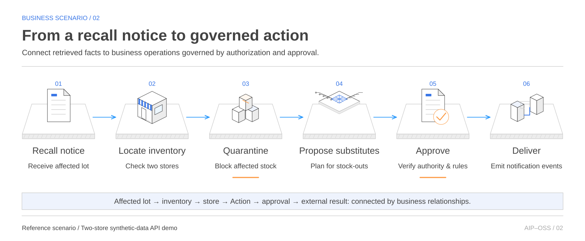
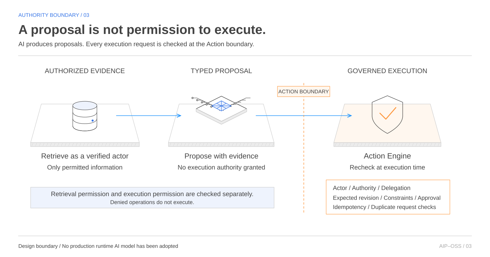
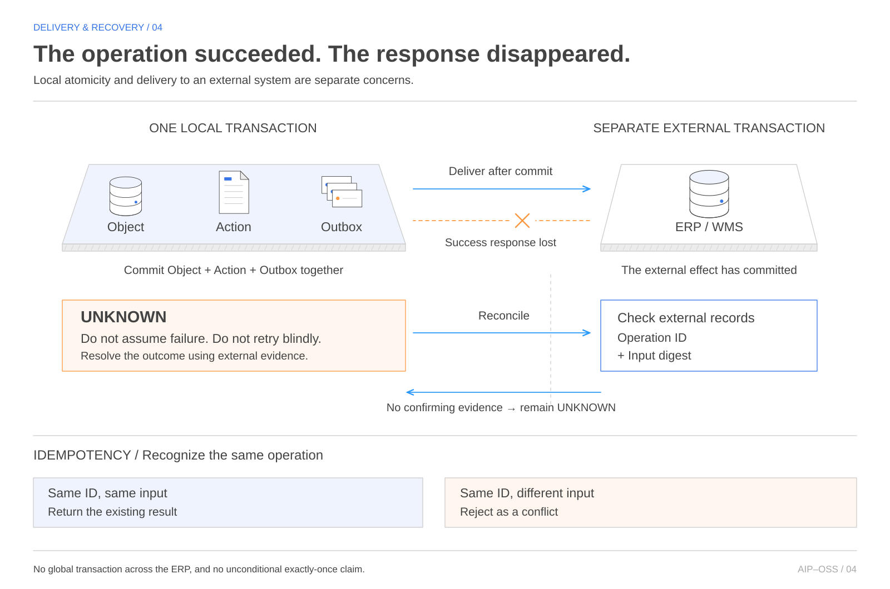

# Your business semantics. Your rules.

This is Hagino's personal development and verification project, entirely unrelated to Canly. It is not company work and uses no real company or customer data. It is not an official Palantir project. The source is available in the [GitHub repository](https://github.com/haginot/aip-oss-platform).

AIP-OSS Platform is a project to connect data, authorization, workflows, and AI through business definitions that an enterprise controls. What counts as inventory? Who may quarantine it? Whose approval does a purchase require? The aim is to keep those meanings and rules independent of any particular database or AI service.

The starting point is not another chat interface. It is a governed path from understanding a business situation to proposing a change and carrying it out. Inspired by the integrated approach of Palantir Foundry, Ontology, and AIP, the project is assembling that path from public contracts and replaceable implementations.

This article follows the questions behind the project: why build it, what the architecture looks like, why PostgreSQL matters, what replacement really requires, and what has actually been tested. The architecture map is a target design. Implementation claims describe a bounded reference implementation; progress is based on records inspected on October 13, 2026.

## 01 Why assemble a platform from existing components?

My interest in Palantir began with the Ontology underlying AIP. I had worked with ontologies in NLP for a long time, but seeing them support AI agents' understanding and execution of business operations surprised me.

That led to a personal hypothesis: could an ontology connect distributed systems while preserving business meaning? In DDD terms, I imagined connecting bounded contexts without collapsing their models into one. Each context retains its language and responsibilities; the integration makes object mappings and conditions for operations explicit. This experiment explores that idea, not a claim about Palantir's original design intent or an equivalence between NLP ontologies, Palantir's Ontology, and DDD. See the [official Ontology overview](https://www.palantir.com/docs/foundry/ontology/overview) and [Bounded Context](https://martinfowler.com/bliki/BoundedContext.html).

There are already many choices for storing data, managing metadata, evaluating authorization, and coordinating long-running work. Protocols for connecting AI to external tools provide another useful piece.

But connecting products does not settle the business contract between them. Does “inventory” mean the same thing in a warehouse system, a search result, an approval screen, and an AI proposal? Is information an employee may read also information that may be exported to an ERP? If inventory or permissions change after approval, is that approval still valid? These questions need answers across the workflow, not just within each component.

Palantir’s public documentation describes an Ontology that connects data as objects and links, logic, and actions for use by applications and AI. That integrated approach is the reference point here, not a reproduction of its interface or internal implementation. [Palantir platform overview](https://www.palantir.com/docs/foundry/platform-overview/overview/index.html)

The motivation is not a categorical claim that no comparable open-source project exists anywhere. It is to connect business meaning, execution, authorization, and recovery through contracts we can control and inspect. Where an existing implementation meets the requirements, use it. Where responsibilities fall between products, make them explicit and test them end to end.

The ambition is integration comparable to Foundry and AIP, with a particular emphasis on replaceability. That is a direction, not evidence of present-day feature parity, operating scale, or production maturity.

## 02 Owning more than the data

The enterprise-owned core consists of the definitions needed to describe business activity, execute it, and explain it afterward: the Ontology, Object API, Actions, authorization composition, Events and Evidence, and the process for releasing those definitions.

An Ontology is more than a table catalog. It identifies stores, product lots, and inventory; defines types, units, and relationships; and states which record is authoritative. The Object API provides a consistent way to retrieve, search, and traverse those objects. Different consumers should refer to the same entity with the same identity and meaning.

An Action is narrower than an API that can change data. It represents a business operation, such as quarantining inventory or ordering a substitute. Its boundary checks not only input types but also the actor, delegation, authority, expected data revision, approvals, and the handling of repeated requests.

Events describe what happened. Evidence records the basis for a decision and who made it. Definitions themselves are versioned, with diffs, review, publication, and compatible rollback. Editing a definition should not silently and unconditionally change the rules under which the business operates.

Ownership does not mean writing every component from scratch. It means being able to carry these definitions and execution guarantees forward when a search engine or policy product changes. It also means retaining responsibility for preserving those guarantees.

## 03 Read the architecture around its business contracts

The map organizes the target design into seven layers, from user entry points to external systems. At its center are Ontology and Objects, Actions and Workflows, and AI and Typed Tools. Data processing and execution sit below them; a Ports and Adapters boundary separates their contracts from particular technologies.

 is also available.")

Read from the top, business applications, authoring tools, APIs, and agents enter through a common trust boundary. It establishes the actor, tenant, and delegation before business operations proceed. Reads return authorized objects and evidence. Changes go through Actions.

Read from the bottom, existing ERPs, databases, files, analytical platforms, and model services are integration points. The design does not assume that all data moves into one place or that every existing system of record is replaced. Each connection needs an explicit source of truth and a clear boundary for committed changes.

The controls on the right—auditing, metadata, definition releases, verification, operations, and recovery—apply throughout. They are not a final layer added after the rest works. The design separates 47 responsibilities, not 47 mandatory microservices. The plan is to make a complete business path work with a small number of components, then separate responsibilities where requirements justify it.

## 04 A recall connects search to business execution

The reference implementation uses a two-store product recall to make the architecture concrete. Find the affected lot, locate stock at each store, and quarantine it. Where needed, continue into substitute purchasing and customer-response workflows. This is an API demo with synthetic data: it places no real orders and contacts no real customers.

The shared business model matters here. A relationship between a lot and inventory lets people and rules refer to the same target. Putting constraints around a quarantine Action reduces the need to implement a different safety check in every screen or agent.

Suppose someone inspects inventory at revision r7, then another person updates it to r8. Accepting the original operation without checking its expected revision would allow an old assumption to change current state. The Action compares expected and current revisions and stops on a mismatch. Changes to approval evidence or definition versions also require revalidation.

This is related to DDD’s ubiquitous language: business language shared with models and APIs. It is not a claim that the entire system implements every part of DDD. The important point is to share not just names, but the conditions under which changes are permitted. [DDD Reference](https://www.domainlanguage.com/wp-content/uploads/2016/05/DDD_Reference_2015-03.pdf)

## 05 The critical choices are boundaries, not product names

There are two answers to “Which middleware is central?” Node.js and PostgreSQL support the current reference implementation. The target platform, however, is organized around public contracts connecting the Ontology, Actions, authorization, and evidence—not around a particular vendor’s product.

Many surrounding responsibilities can benefit from existing technologies. The examples below illustrate candidate roles, not adopted or completed integrations. Licensing and operating requirements must be checked for the specific versions selected.

| Area | Example products or standards | Responsibility retained by the platform |
| --- | --- | --- |
| Catalog and lineage | OpenMetadata, DataHub | Map business definitions to data and identify authoritative sources |
| Identity | OIDC, Keycloak, Dex, SPIFFE | Establish who acts, on whose behalf, and within what scope |
| Authorization | OpenFGA, OPA, Cedar | Compose relationships, attributes, delegation, and denial behavior |
| Workflows and events | Temporal, Kafka, NATS | Preserve approval validity, retry behavior, ordering, and failure semantics |
| Search, graph, and vectors | OpenSearch, Neo4j, Qdrant, pgvector | Preserve permissions, freshness, source mappings, and rebuildability |
| Analytics and operations | Iceberg, Trino, Kubernetes, OpenTelemetry | Preserve business meaning and release, audit, and recovery conditions |
| AI tool connections | MCP, model adapters | Scope evidence access and reauthorize Action execution |

OpenMetadata, for example, is a candidate for data discovery, cataloging, lineage, and quality. In this design, that does not make it the execution boundary for business Actions. Understanding which data exists and deciding what may be done with it are separate responsibilities. [OpenMetadata documentation](https://docs.open-metadata.org/latest)

A Port therefore needs more than method names and input and output types. Its contract includes authentication context, versions, deadlines, cancellation, trace identifiers, typed errors, and supported capabilities. This follows the Ports and Adapters approach to separating business rules from technology implementations. [Hexagonal Architecture](https://alistair.cockburn.us/hexagonal-architecture)

## 06 PostgreSQL matters because business changes must commit coherently

PostgreSQL may seem an unexpected centerpiece of an AI platform. The first requirement here is not sophisticated retrieval alone. It is agreement about how far a business operation has committed.

Imagine inventory marked as quarantined with no record of the Action that did it, or a successful Action whose external-delivery record disappeared. To avoid those partial states, the reference implementation commits Object changes, the Action, history, the Outbox, and successful Audit records in one PostgreSQL transaction. The Outbox records committed changes that must later be delivered elsewhere.

PostgreSQL transactions provide a foundation for committing or rolling back a group of updates together. They do not automatically establish business safety. The application must still check revisions, authorization, constraints, and approvals, then correctly couple those checks to the updates. [PostgreSQL transactions](https://www.postgresql.org/docs/current/tutorial-transactions.html)

Keeping state, relationships, history, and derived read data in a small initial deployment also helps make the complete workflow testable, including failure cases. Specialized search or analytical implementations can follow where their requirements justify the additional boundary.

PostgreSQL is therefore an important foundation of the reference implementation, not the definition of the product. Hiding SQL behind an interface is insufficient: another implementation must preserve the same commit, authorization, and recovery conditions.

## 07 Alternatives to PostgreSQL—and what replacement tests prove

It helps to distinguish moving search out of PostgreSQL from replacing the authoritative store itself. Full-text search, graph traversal, or vector retrieval can use a separate engine while PostgreSQL remains the source of truth. That is a valid decomposition, but it is not a PostgreSQL-free architecture.

Replacing the authoritative store could involve another relational database or distributed SQL system. Document or key-value storage is also possible in principle, but the design must establish how Objects, Actions, and the Outbox remain consistent, how revision conflicts are detected, and how uncertain outcomes are recovered. A graph database’s suitability for relationships does not, by itself, establish safe business commits.

Making an event store authoritative is a larger architectural change. The reference implementation holds current state and history; an event-sourced design reconstructs state from an event sequence. It must account for ordering, replay, schema evolution, and lagging read models. That is more than changing a connection string.

What has this project actually exercised? The inspected records describe a comparison between reads that scan canonical PostgreSQL records and a persistent JSONB-derived index, followed by cutover and rollback. Both sides are compared within the same database and SQL snapshot.

This is evidence of a replacement path involving a stateful adapter. It is not evidence of migration from PostgreSQL to a different product, an asynchronously replicated read database, or improved performance. A replaceable design and a validated individual replacement are different claims.

A future adapter needs more than API conformance. It needs checks for authorization visibility, equivalent query meaning, state migration, shadow comparisons, requests during cutover, and rollback. Matching search results is not enough if a replacement leaks unauthorized counts or reuses approvals that are no longer valid.

## 08 A proposal is not permission to execute

Adding AI should add an entry point into the business, not a bypass around its rules. The design gives an agent authorized data and evidence, then lets it construct a proposal for a typed Action. Whether that proposal may execute is decided again at the Action boundary.

An agent might suggest purchasing a substitute during a recall. Execution must still stop if the inventory evidence is stale, delegation has expired, or the amount exceeds the approved scope. An approver’s broader permissions must not silently broaden what the original proposal was allowed to see or do.

MCP is a candidate protocol for connecting AI to tools, but connection authorization and business-operation validity require distinct design decisions. An MCP call would still pass through Action checks. Adopting the protocol alone is not evidence that business authorization is complete. [MCP authorization specification](https://modelcontextprotocol.io/specification/latest/basic/authorization)

The reference implementation has a typed tool-proposal path that revalidates authorized evidence. It has not adopted a business-runtime model service. Using AI to develop the project and deploying an AI model inside the product are separate facts.

## 09 Distinguish failure from an unknown outcome

The difficult cases are not limited to operations that fail cleanly. What if an ERP commits an order, then the connection drops before the success response arrives? Treating the request as failed and blindly retrying it can place a duplicate order.

The reference implementation treats this as UNKNOWN. It preserves the delivery intent and operation identity, stops blind resends, and reconciles against the external record and a digest of the input. If it cannot establish the outcome, it keeps that uncertainty visible. Preserving the evidence needed to avoid duplicate effects matters more than making an error disappear.

The Object and Outbox may commit together locally, but the ERP is outside that transaction. Outbox delivery, deduplication, ordering, reconciliation, and, where necessary, compensation work together across the boundary. If an external system cannot deduplicate or look up an operation by identity, the adapter and operating procedure must account for that limitation.

Business-continuity exercises extend the same reasoning to WAN or ERP failures, process restarts, and database restoration. The inspected records cover logical backup restoration in a local synthetic environment. Clean-recovery cases require zero lost, duplicate, or unresolved effects. A case that loses committed data after a checkpoint deliberately reports one lost mutation and a manual hold.

Making loss explicit supports evaluation of the recovery point objective, or RPO, and recovery time objective, or RTO. It does not turn a local exercise into a production SLA. Physical WAL replay and simultaneous host loss are outside the inspected validation scope.

## 10 What exists today, and what still needs evidence

The development checkout’s acceptance matrix inspected on October 13, 2026 records AC-001 through AC-008 as PASS and AC-009, the final audit, as READY_FOR_REVIEW. These PASS labels refer to linked machine-verification records. They are not a declaration that the product is complete or that the final independent audit has approved it. This article revision inspected the records; it did not rerun the full product test suite.

| Area | Scope supported by the inspected records | What it does not establish |
| --- | --- | --- |
| Kernel, authorization, and Actions | Real PostgreSQL and HTTP checks for types, revisions, allow/deny behavior, deadlines, conflicts, and retries | Guarantees for every domain model or integration |
| Store workflow | Synthetic two-store recall, quarantine, approval, substitute purchasing, and customer-response paths | Live store deployment or real customer delivery |
| Recovery | Local logical restoration, external-effect reconciliation, and measurement of loss and duplicates | A production SLA, physical WAL recovery, or simultaneous host loss |
| Replaceability | Comparison, cutover, and rollback of a persistent derived index within PostgreSQL | Migration to a non-PostgreSQL store or a performance advantage |
| Release readiness | Startup, supply-chain, and operating-procedure verification records; final audit awaiting approval | Overall completion or production certification |

Development uses TAKT workflows to separate implementation from independent review sessions. A successful test result is tied to its inputs, check definitions, and outputs. When code or definitions change, an old success cannot establish the current result. Counterexamples and failed runs found during review remain part of the record.

This keeps the speed of AI-assisted development from becoming a substitute for evidence. Implementing something, passing tests, obtaining independent review, and being ready to operate a product are different judgments. A dated summary is available in the [verification snapshot](reference/IMPLEMENTATION_SNAPSHOT.md).

The next obligations are final independent audit of the repaired system and conformance, migration, and recovery validation for each integration actually adopted. Introducing a model also requires evaluating proposal quality and business outcomes, not only authorized retrieval. Connecting every product named on the architecture map at once is not the completion criterion.

The goal is a platform in which an enterprise can understand and define its business, and people and AI operate under the same execution rules. When a better database, search engine, policy product, or model becomes available, the business meaning should be portable. That ability to keep the definitions while choosing the technology again is the central idea behind AIP-OSS Platform.

## Design references

See [PRODUCT_GOAL.md](reference/PRODUCT_GOAL.md) for goals and acceptance criteria, [ARCHITECTURE_BASELINE.md](reference/ARCHITECTURE_BASELINE.md) for responsibilities and boundaries, and [DEMO_SCENARIOS.md](reference/DEMO_SCENARIOS.md) for the demonstration scenarios. These are design documents, not evidence that every described capability is implemented.

This introduction was fully rewritten from the project discussion. It is an independent project, not an indication of affiliation with or endorsement by Palantir.
